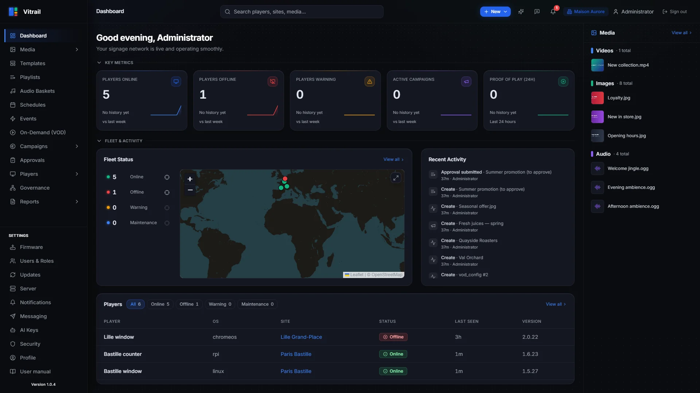
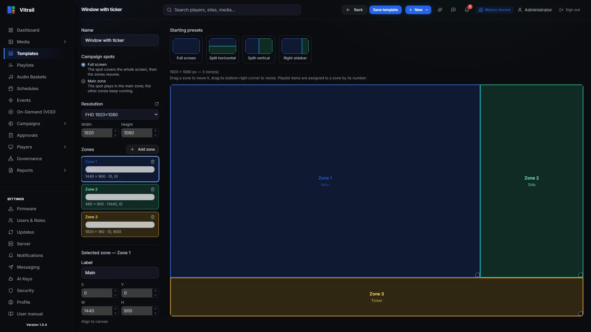
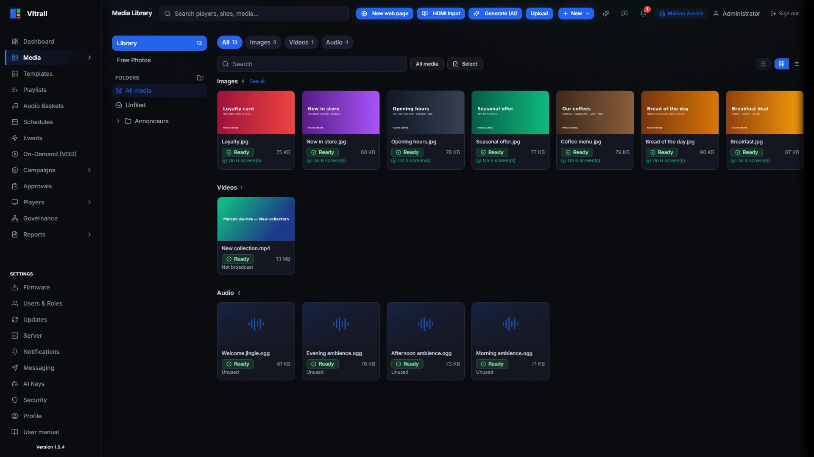
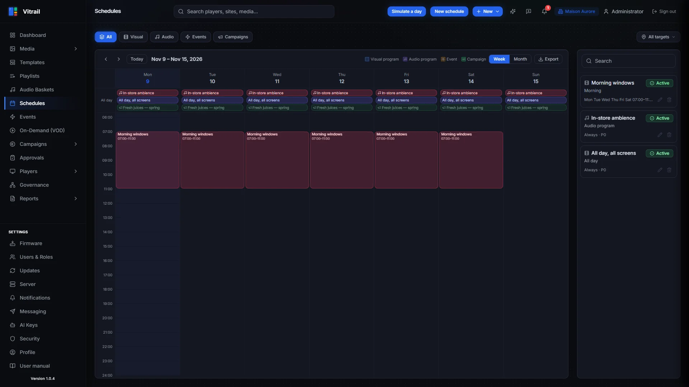

<p align="center"></p>

# Vitrail

<p align="center">
  <a href="LICENSE"></a>
  <a href="https://github.com/edkahall/vitrail/releases/latest"></a>
  <a href="https://github.com/edkahall/vitrail/actions/workflows/ci.yml"></a>
</p>

**Vitrail** is a free and open-source **digital signage platform**: a multi-tenant web CMS plus
players for **Linux, Windows, Raspberry Pi, Android, ChromeOS (PWA), a Chrome extension and
BrightSign**. It is self-hosted and runs entirely on your own server. No cloud account is needed,
and nothing phones home.

**Stack:** FastAPI (Python 3.12) · PostgreSQL 16 (+ pgvector) · Redis 7 · Celery 5 · Next.js 15 · MinIO

<p align="center">
  
  
  
  
</p>
<p align="center"><sub>Demo data generated by <code>backend/scripts/seed_demo_content.py</code> — more screenshots in the <a href="frontend/public/help/manual.en.md">user manual</a>.</sub></p>

### Features

- **Content:** media library, playlists, multi-zone templates (any canvas resolution, portrait,
  LED), documents (PDF/PPTX), web pages, RSS and data feeds, VOD
- **Scheduling:** programmes, events, priorities, targeting by player, group, site or tags
- **Fleet:** provisioning by token, OTA updates (with canary), remote commands, screen power
  schedules, HDMI/RS-232 display control, LAN synchronisation between players, video walls
- **In-store audio:** music baskets with automatic ducking for jingles and messages
- **Retail media:** share-of-voice inventory, advertiser self-service portal, approval workflow,
  competitive exclusion, reports
- **Proof of Play:** play logs signed on the player (Ed25519) and sealed in Merkle trees
- **Governance:** hierarchical delegation across organisations, sites and groups; RBAC with
  custom roles; PostgreSQL row-level security between tenants
- **Analytics:** executive dashboard, network health score, scheduled PDF reports
- **AI (optional, bring your own keys):** content generation, a documentation-aware assistant,
  and a Telegram agent
- **Notifications:** webhooks (HMAC-signed) and email
- **Interface in 5 languages** (EN, FR, DE, ES, PT); players display English

---

## 📘 Getting started

**→ [Operator's guide](docs/GUIDE.md)** · 🇫🇷 [Guide d'exploitation](docs/GUIDE.fr.md)

Part 1 gets a server and a first screen running in about 15 minutes, on your own machine and
any web browser. Part 2 covers production: sizing (with or without a GPU), HTTPS, every player
platform, updates, backups, the Telegram assistant.

## Installing a server

`install-ubuntu.sh` installs a server from source on a fresh Ubuntu machine (tested on
Ubuntu 24.04, 4 vCPU / 8 GB):

```bash
curl -fsSL https://raw.githubusercontent.com/edkahall/vitrail/main/install-ubuntu.sh -o install-vitrail.sh
sudo bash install-vitrail.sh
```

It installs Docker if needed, clones the repo into `/opt/signflow`, generates a `.env` with
random secrets, builds and starts the containers, runs the migrations, sets up a systemd service
and an nginx front on port 8080, then creates the first organisation and administrator. The
administrator's credentials and 2FA secret are printed **once** at the end: note them.

Known limitation: it serves plain **HTTP** on port 8080. When `ufw` is active, the installer
opens that port to **private networks only**; set `VITRAIL_PUBLIC_HTTP=1` to open it to everyone
(fine for a quick trial, not for production). For access over the Internet, put the stack behind
a reverse proxy with TLS (see `deploy/caddy/Caddyfile.example`).

To create a **super-admin** (the platform role that manages organisations), run this on the
server; shell access is the only requirement:

```bash
docker compose exec -T backend python3 /app/scripts/create_super_admin.py --email you@example.com
```

## Installing a player

In the interface, go to **Players → Provisioning**: you get an `sfp_` token, a downloadable
payload, or an SD card for BrightSign. In the field, the `signflow-provision` tool installs a
player over **SSH** (Linux/RPi), **WinRM** (Windows) or **ADB** (Android), or builds an **SD
image** for a new Raspberry Pi that needs no intervention at first boot. See
[`installer/README.md`](installer/README.md) and [`docs/RUNBOOK_POSE_PLAYER.md`](docs/RUNBOOK_POSE_PLAYER.md).

One security rule never changes: **connections always go from the player to the server**. No
inbound port is opened on the player's network.

## 🤖 Install with an AI assistant

This repository ships a [`CLAUDE.md`](CLAUDE.md) that briefs an AI assistant on Vitrail: the
installation steps, the checks to run after each one, the pitfalls met on real installs, and
safety rules (ask before anything destructive, never print secrets).

- **With [Claude Code](https://claude.com/claude-code)**: clone the repository on your server
  and run `claude` in it. Claude reads `CLAUDE.md` automatically and can walk you through the
  installation, run the checks with you and help you troubleshoot.
- **In a chat** (claude.ai or another assistant): download
  [`CLAUDE.md`](https://raw.githubusercontent.com/edkahall/vitrail/main/CLAUDE.md), add it to
  the conversation and ask for help installing Vitrail.

The assistant answers in your language. It is the same content as the guide, written for an
assistant: the guide stays the reference.

---

## Repository layout

```
backend/           FastAPI + Celery (API, engines, media/feed/promo workers)
frontend/          Next.js (App Router, next-intl, Tailwind): web CMS + advertiser portal
player-linux/      Electron, Debian (X11 + openbox)
player-windows/    Electron, Windows 11
player-rpi/        Electron, Raspberry Pi OS (Wayland + cage)
player-android/    Native Android app (ExoPlayer)
player-chromeos/   ChromeOS kiosk PWA (served code: frontend/public/player-chromeos/)
player-extension/  Chrome extension (zero hardware)
player-brightsign/ BrightScript autorun (BrightSign BOS)
installer/         Field provisioning tool (multi-channel Python CLI + RPi SD image)
mobile/            Companion mobile app
feed-proxy/        Feed proxy (RSS, social…) with SSRF protection
deploy/            Deployment helpers (backups, load tests, TLS example)
docs/              Technical documentation and guides
```

The user manual is built into the interface (**Help** menu, 5 languages). Its source lives in
`frontend/public/help/`.

## Development

To work on the code rather than run a server:

```bash
cp .env.example .env            # fill in the secrets (see the comments in the file)
docker compose up -d
make dev-init                   # migrations + MinIO bucket (first run only)
docker compose exec -T backend python3 /app/scripts/bootstrap.py   # first organisation + admin (prints the credentials)
```

The base `docker-compose.yml` publishes **no ports** for postgres, redis, backend or frontend.
Put your port bindings in a `docker-compose.override.yml` (gitignored). That way the stack can
share a machine with other services.

- Frontend: `cd frontend && npm ci && npm run dev`
- Backend tests: `make test` (needs postgres, redis and minio running)
- End-to-end tests: `cd frontend && npx playwright test`

## Technical notes

The project was born under the working name *SignFlow*. Technical identifiers still carry it
(`SIGNFLOW_*` variables, the `X-SignFlow-*` webhook headers, the server directory
`/opt/signflow`, the Windows player's install folder and scheduled task "SignFlow Player") so
that existing installations keep working. Everything shown on screen says Vitrail, and the
Android app is `app.vitrail.player` since v1.0.3.

## Contributing

Contributions are welcome: bug reports, fixes, translations, new players, documentation. Read
[`CONTRIBUTING.md`](CONTRIBUTING.md) first. Every commit must be signed off (Developer
Certificate of Origin).

To report a security issue, **do not open a public issue**. Follow [`SECURITY.md`](SECURITY.md).

## Licence

Copyright © 2026 Ed Kahall and the Vitrail contributors.

Vitrail is free software, licensed under the **GNU Affero General Public License v3.0 or later**
([`LICENSE`](LICENSE)). You may use, study, modify and redistribute it, commercially or not.
If you distribute it, or let users interact with a modified version **over a network**, you must
make your source code available under the same licence.

Third-party components keep their own licences: see [`THIRD_PARTY_NOTICES.md`](THIRD_PARTY_NOTICES.md).
