# Manuel utilisateur Vitrail

## Bienvenue dans Vitrail

Vitrail est une plateforme d'affichage dynamique (digital signage) : vous diffusez des contenus (vidéos, images, pages web, flux d'actualité, audio) sur des écrans pilotés par des players, depuis une interface web centralisée.

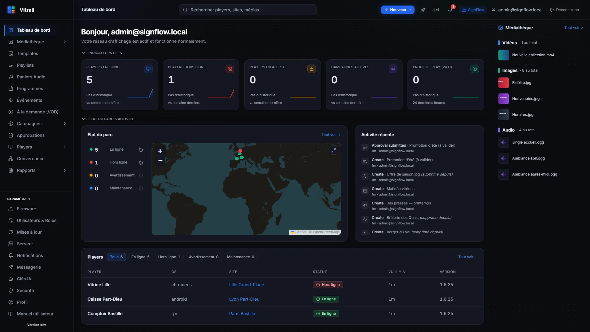

### Les grands concepts

- **Organisation** : votre espace de travail. Contenus, players et utilisateurs y sont isolés des autres organisations.
- **Player** : le logiciel installé sur l'appareil branché à un écran (NUC Linux, Raspberry Pi, PC Windows, box Android, Chromebox, BrightSign, ou une simple extension Chrome). Il reçoit ses consignes du serveur — jamais l'inverse — et continue de fonctionner hors-ligne.
- **Média** : un contenu importé (vidéo, image, document) ou dynamique (page web, flux, entrée HDMI).
- **Playlist** : une suite de médias jouée en boucle.
- **Programmation (schedule)** : quand et sur quels players une playlist est diffusée.
- **Événement** : une diffusion ponctuelle ou déclenchée qui prend la priorité sur la programmation normale.
- **Campagne** : de la publicité d'annonceur intercalée dans vos boucles, vendue en part de voix (retail media).

### Le parcours type

1. **Enrôler un player** : générez un token de provisioning, installez le player, il apparaît dans Players.
2. **Importer du contenu** dans la Médiathèque.
3. **Créer une playlist** avec ce contenu.
4. **Programmer** la playlist sur un ou plusieurs players.

L'écran affiche le contenu quelques secondes après l'enregistrement de la programmation.

> Un menu ou une action vous manque ? C'est probablement une question de rôle : demandez à votre administrateur d'organisation (voir « Utilisateurs, rôles et sécurité »).

## Players

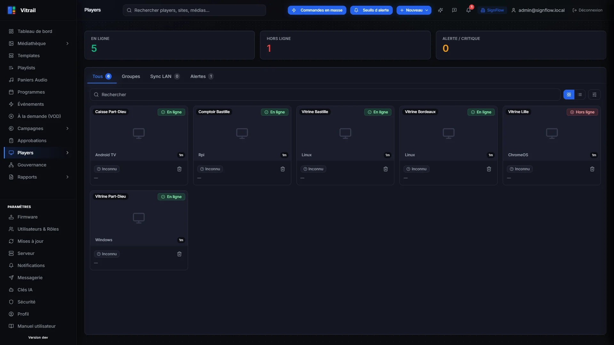
### Enrôler un player

Un player rejoint votre organisation grâce à un **token de provisioning** :

1. **Players → Provisioning** → **Nouveau token** (barre du haut).
2. Choisissez le nombre maximum de players et une expiration (ou « Sans expiration »).
3. Copiez le token (`sfp_…`) et fournissez-le à l'installation du player avec l'URL du serveur.

Au premier démarrage, le player échange le token contre son identité permanente et apparaît dans **Players**. Un token actif peut être **révoqué** (il n'enrôle plus, les players déjà enrôlés continuent) puis supprimé.

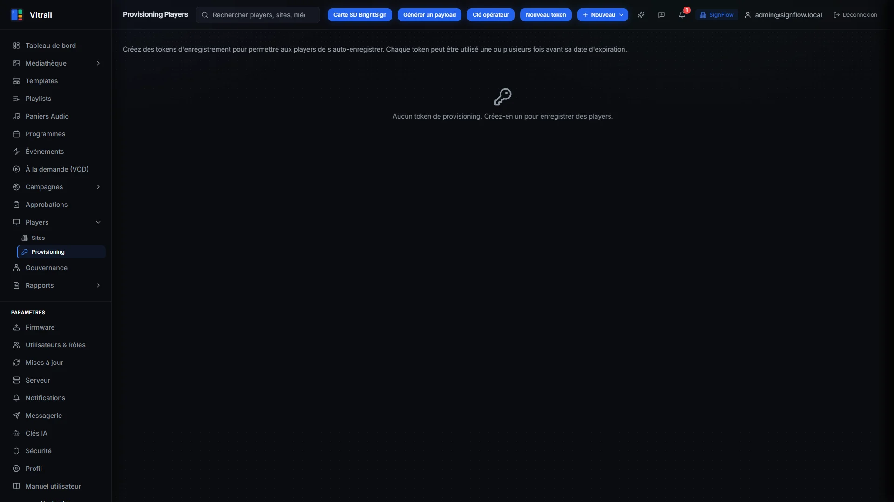

### Provisioning en lot et clé USB

Le drawer **Générer un payload** prépare la configuration de plusieurs machines d'un coup : mode par machine ou réglages partagés, import CSV, résolution (Auto/HD/FHD/4K/8K/personnalisée), Wi-Fi, ré-attachement d'un player existant (liste avec recherche). Le payload s'applique par clé USB sur les players Linux préparés, ou par carte SD pour BrightSign.

### Surveiller et configurer à distance

La liste des Players affiche l'état (en ligne / hors-ligne / veille programmée) avec la date de dernier contact. Le drawer d'un player donne : machine, écran, réseau, fuseau horaire, inventaire de médias, capture d'écran récente, capacités de décodage.

Sans SSH, vous pouvez pousser : résolution, rotation, volume, son, moteur de rendu, fuseau horaire, plafond de bande passante. Le bouton **« Infos à l'écran »** affiche un panneau de diagnostic directement sur l'écran (nom, réseau, programme en cours, média joué) — pratique pour identifier un écran à distance. Boutons ponctuels : redémarrer l'application, redémarrer la machine, forcer la resynchronisation, capture d'écran. Le bouton **« Commandes en masse »** de la barre du haut envoie la même commande à toute une cible (organisation, site, groupe de sites, groupe de players) ; un aperçu liste les écrans concernés **avant** l'envoi, et les commandes destructives (redémarrage, arrêt de l'application, maintenance) exigent une case de confirmation **et votre PIN**.

Deux réglages « campagnes » vivent aussi dans ce drawer : **Exclu des campagnes publicitaires** (opt-out) et **plafond d'occupation publicitaire** (voir Campagnes).

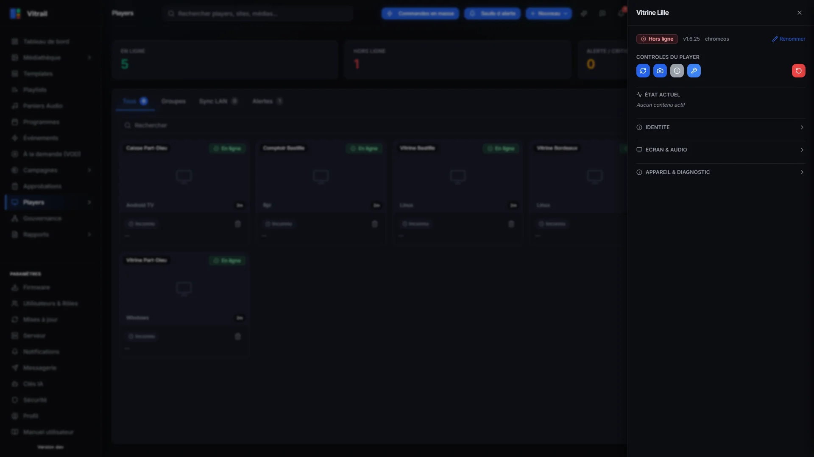

### Groupes et synchronisation LAN

Les **groupes de players** servent de cible de diffusion et portent la **synchronisation LAN** : plusieurs players du même réseau local jouent la même vidéo image par image (mur d'écrans, ambiance cohérente). La synchronisation est fiable quand le groupe est **homogène** (même matériel) et que les players partagent la même horloge (voir NTP). Un player du groupe peut être désigné **relais NTP**.

### Extension Chrome (sans matériel)

L'extension Chrome transforme un navigateur en player : idéale pour tester ou équiper un poste existant. Chargez l'extension (mode développeur), saisissez l'URL du serveur et un token `sfp_…`. Limites : pas de synchronisation LAN, mode hors-ligne réduit. Pour un vrai kiosk ChromeOS, utilisez le player ChromeOS PWA.

## Sites

Un **site** représente un lieu physique (magasin, agence). Chaque player est rattaché à un site.

- **Fuseau horaire** : toute la programmation s'exécute en heure locale du site. Un player rattaché est automatiquement aligné sur le fuseau du site (badge d'alerte en cas d'écart, correction à distance depuis son drawer).
- **Horaires d'ouverture** : jours et heures, avec **exceptions datées** (férié, inventaire, soirée) et fermeture automatique les **jours fériés** (calendrier régional optionnel). Un jour non renseigné est fermé. Ces horaires pilotent l'allumage des écrans (voir « Écrans et alimentation ») et sont connus de l'assistant (« le site X est-il ouvert dimanche ? »).
- **Serveur NTP** : pour que tous les players du site partagent la même horloge (indispensable à la synchronisation LAN).
- **Coordonnées** : positionnez le site sur la carte (utilisée par les rapports géo et le portail annonceur).
- **Catégories exclues** : les catégories d'industrie interdites de publicité sur ce site (voir Campagnes).
- L'onglet **Groupes de sites** crée des ensembles (région, enseigne) utilisables comme cible dans les programmations, événements, campagnes et mises à jour.

Au survol d'un site (liste), une infobulle résume ses players et son occupation publicitaire à 7 jours.

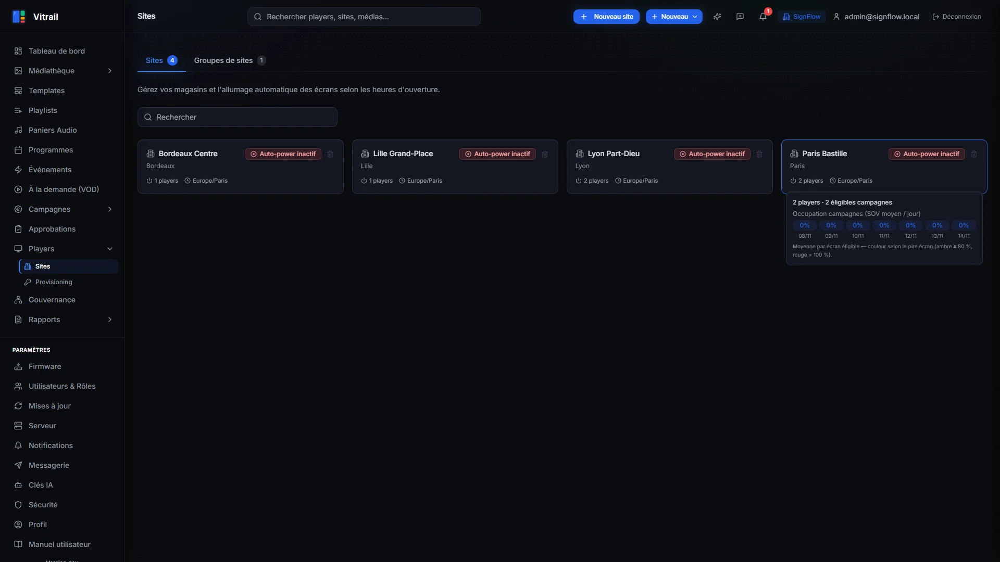

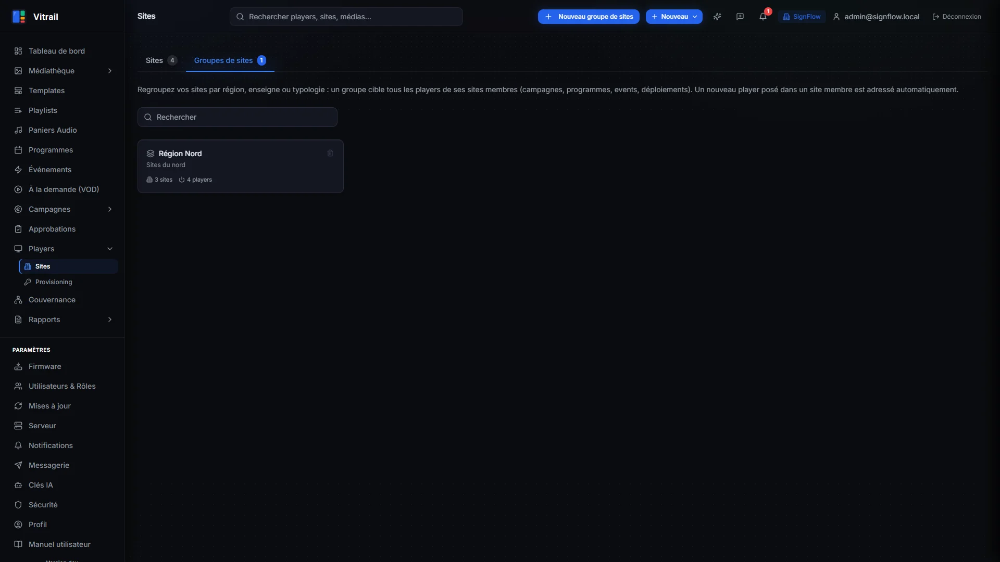

## Médiathèque

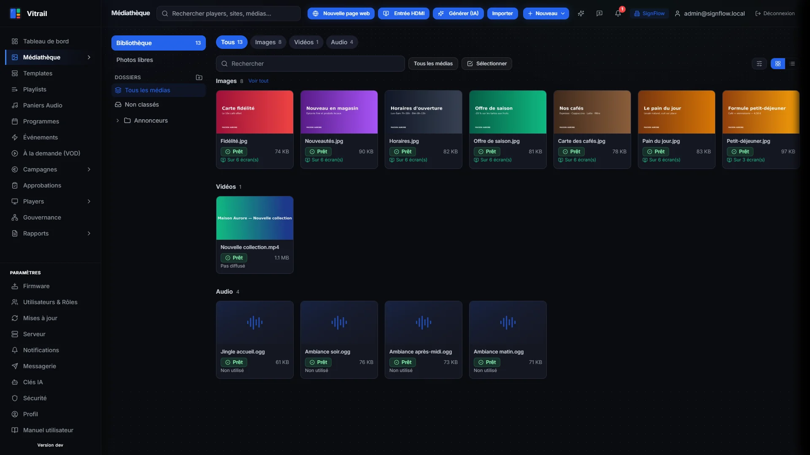
### Importer

**Médiathèque → Importer** : vidéos, images, documents (PDF). L'onglet **Photos libres** puise dans Unsplash/Pexels avec attribution automatique. Une vidéo est transcodée automatiquement en format universel : le contenu précédent reste diffusé pendant le traitement, aucun écran ne passe au noir. Si la politique de **renditions** de l'organisation est active, une vidéo 4K génère aussi une version Full HD — chaque player reçoit la résolution adaptée à son écran.

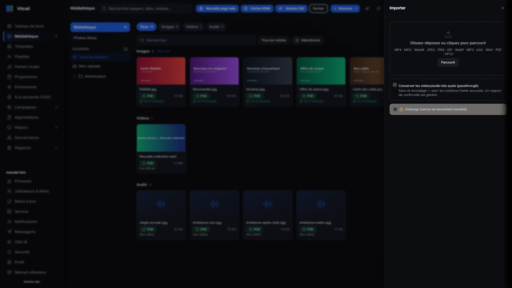

### Organiser

- **Dossiers** et sous-dossiers (colonne de gauche), déplacement en masse.
- **Tags** : taxonomie par espaces de noms (Médiathèque → Tags), assignation multiple, et **filtrage par tags au niveau des players** (un player ne joue que les contenus correspondant à ses tags).
- Recherche, filtre par type (images/vidéos/audio/documents/pages web), pagination.

### Gérer le cycle de vie

- **Remplacer le fichier** d'un média sans changer son identité : les playlists qui l'utilisent ne bougent pas, la bascule est atomique en fin de transcodage.
- **Supprimer en toute sécurité** : la modale d'impact liste playlists, programmes, événements et paniers qui utilisent le média, et l'état de diffusion, avant la suppression en cascade.
- **Quarantaine** : bloquer immédiatement un média sur tout le parc (même hors-ligne), puis le débloquer ou purger son cache.
- **Conformité** : chaque vidéo porte un verdict (prête / diffusable / non conforme) sur ses caractéristiques d'encodage, avec ré-analyse et mode passthrough (garder le fichier d'origine sans ré-encodage).

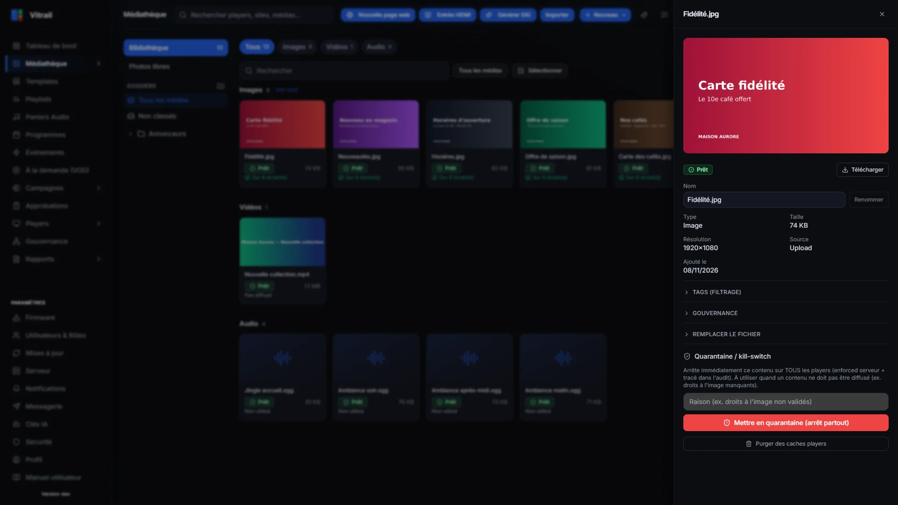

## Templates

Les **templates** définissent des mises en page multi-zones (vidéo principale + bandeau + logo…). L'éditeur travaille à la **résolution du canvas** déclarée (FHD, 4K, portrait, LED sur mesure) — choisissez la résolution de l'écran cible. Une playlist associée à un template alimente ses zones ; un avertissement s'affiche si la résolution du template ne correspond pas à l'écran ciblé.

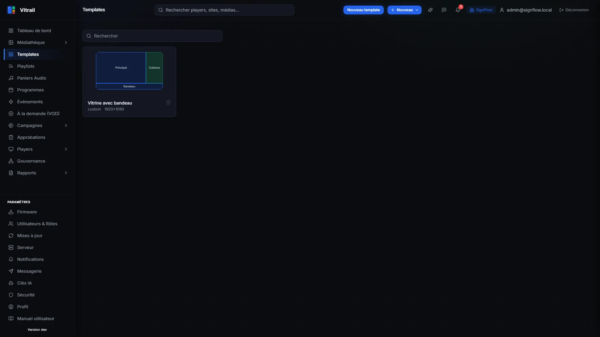

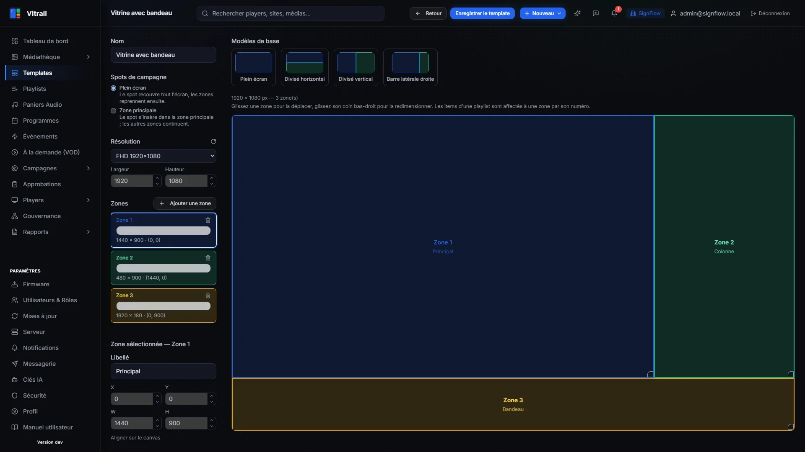

## Playlists

1. **Playlists → Nouvelle playlist**, puis ajoutez des médias (multi-sélection, recherche, dossiers).
2. Réglez l'ordre, la durée d'affichage des images/documents et la zone (si template multi-zones). Les **vidéos affichent leur durée native** — elle se lit, elle ne se règle pas.
3. Les modifications s'accumulent en **brouillon** : le bouton **Publier** les pousse aux players d'un coup (bascule propre, jamais d'état vide).

L'en-tête de l'éditeur et chaque vignette de playlist affichent **le nombre de contenus et la durée totale** de la boucle ; le total suit vos modifications en direct, brouillon compris.

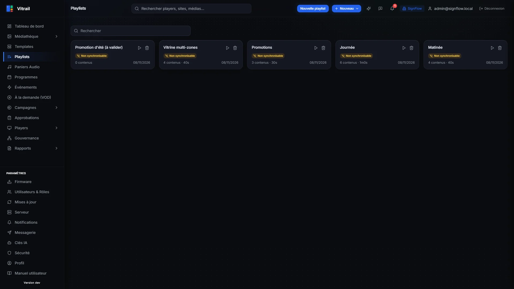

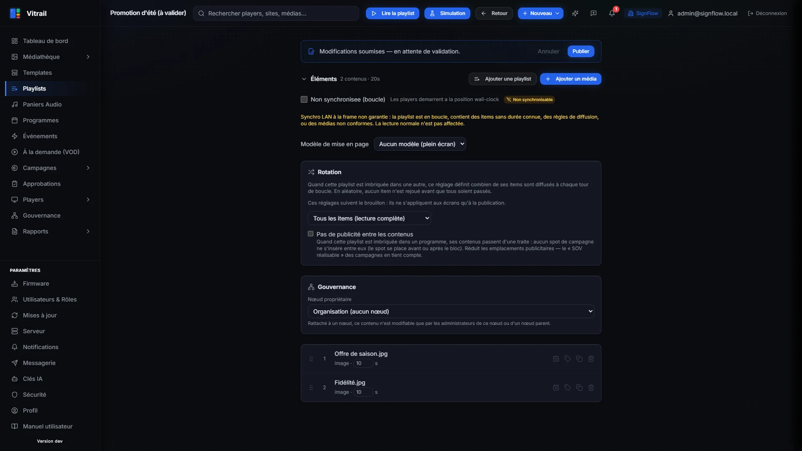

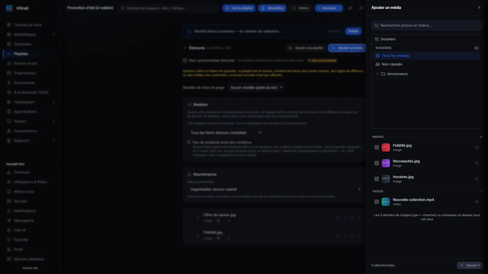

### Visualiser une playlist

Le bouton **lecture** — sur la carte d'une playlist ou dans l'éditeur — déroule la boucle comme le ferait un écran. Sur une playlist posée sur un **template multi-zones**, l'aperçu compose toutes les zones à la fois, au ratio du template, chaque zone avançant sur son propre minuteur.

C'est un aperçu, pas le miroir d'un écran : chaque zone part du début de sa boucle, et la rotation, les spots de campagne et le filtrage par tags n'y sont pas rejoués. Les flux, pages web et entrées HDMI sont nommés à leur vraie place et à leur vraie taille — ils sont produits sur l'écran, au moment de la diffusion.

### Règles de diffusion par item

Chaque item peut porter sa propre règle : jours de la semaine, créneau horaire, plage de dates de validité — en heure locale du player. Des **exceptions par cible** raffinent : tel player ou groupe joue l'item selon une règle différente. Un item sans règle est perpétuel.

### Playlist rotation (N items par tour)

Une playlist peut être **imbriquée dans une autre** comme un item (bouton **Ajouter une playlist** dans l'éditeur). Son réglage **Rotation** décide du comportement :

- **Tous les items** : la sous-playlist se joue en entier à chaque tour de boucle.
- **N par tour — dans l'ordre** : N item(s) par tour, les suivants au tour d'après (avec 5 vidéos et 2 par tour : 1-2, puis 3-4, puis 5-1…).
- **N par tour — aléatoire** : ordre mélangé, aucun item rejoué avant que tous soient passés, re-mélange ensuite.

Un seul niveau d'imbrication ; une playlist référencée comme sous-playlist ne peut pas être supprimée (retirez-la d'abord des playlists parentes). Les règles et tags par item se posent sur les items **de la sous-playlist**. La rotation reste **synchronisée** entre écrans d'un même groupe LAN et la **simulation timeline** montre le déroulé réel tour par tour. Si la même sous-playlist apparaît **plusieurs fois** dans une boucle, toutes ses occurrences jouent le **même item au même tour** (tirage partagé, gage de déterminisme) — pour varier au sein d'un tour, augmentez « Items par tour ».

Ces réglages **suivent le brouillon**, comme les contenus : les modifier fait apparaître le bandeau « Modifications non publiées », et les écrans continuent de jouer la boucle publiée jusqu'à ce que vous cliquiez sur **Publier** (ou, pour une playlist gouvernée sous modération, jusqu'à l'**approbation**).

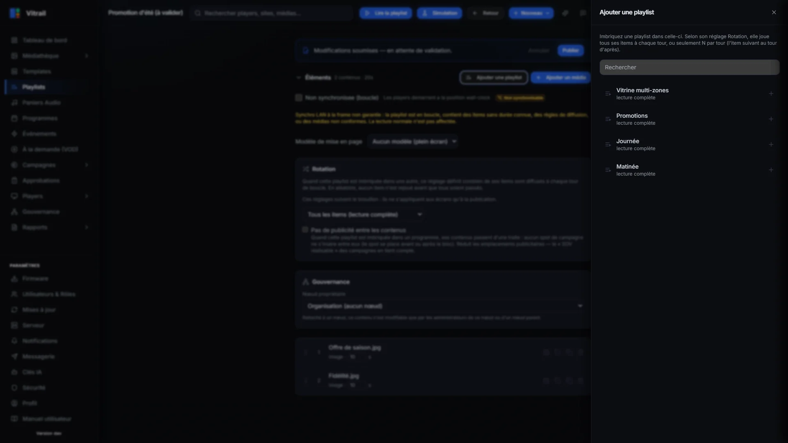

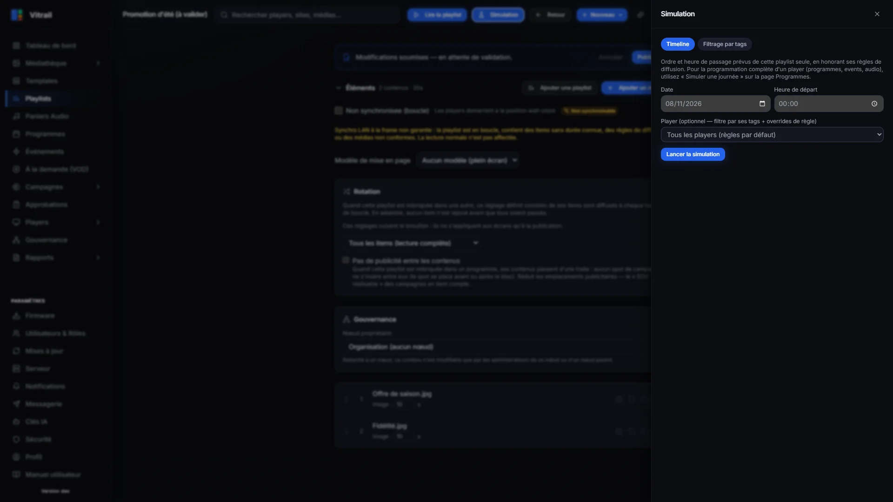

## Paniers audio

Les **paniers audio** diffusent un fond sonore en magasin, indépendant du contenu visuel : musique de fond, jingles à intervalle ou à heure fixe, avec **ducking** automatique (la musique baisse pendant un jingle). Chaque player a un **rôle audio** : contenus standards (son des vidéos), audio seul, ou mixte (fond sonore + vidéos coupées). Le **panneau de contrôle magasin** (LAN) permet à l'équipe sur place d'agir sans compte CMS. Chaque vignette de panier affiche **le nombre de pistes et la durée totale**. Les rapports SACEM s'appuient sur les diffusions prouvées.

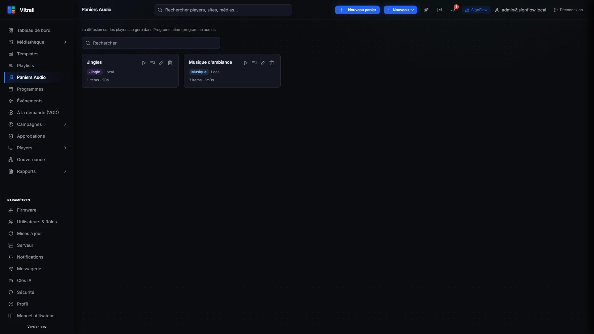

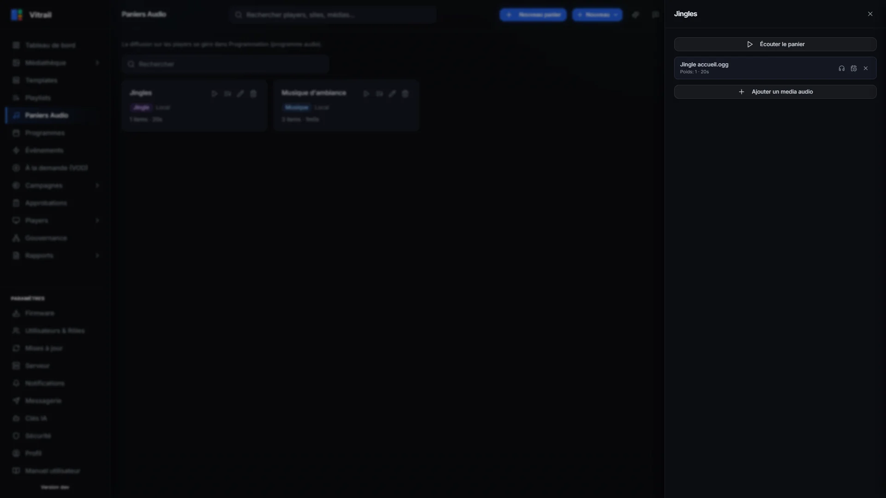

## Programmation

Une **programmation** dit quoi diffuser (une playlist), où (players, groupes, sites, groupes de sites, tags) et quand (jours, créneaux, plage de validité, priorité).

1. **Programmation** → créez une règle, choisissez playlist, cibles et fenêtre temporelle.
2. Les players concernés se mettent à jour en quelques secondes.
3. Le **calendrier unifié** superpose programmes visuels et audio, événements et campagnes (légende à icônes). Filtrez par type (pastilles Tout/Visuels/Audio/Événements/Campagnes) ou par **cible** (groupe de sites, site, player) ; l'**export CSV** suit les filtres actifs. En cas de chevauchement, la **priorité** la plus haute gagne.

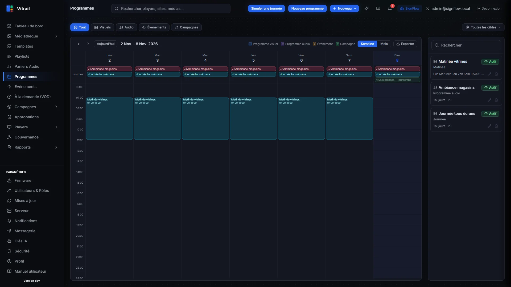

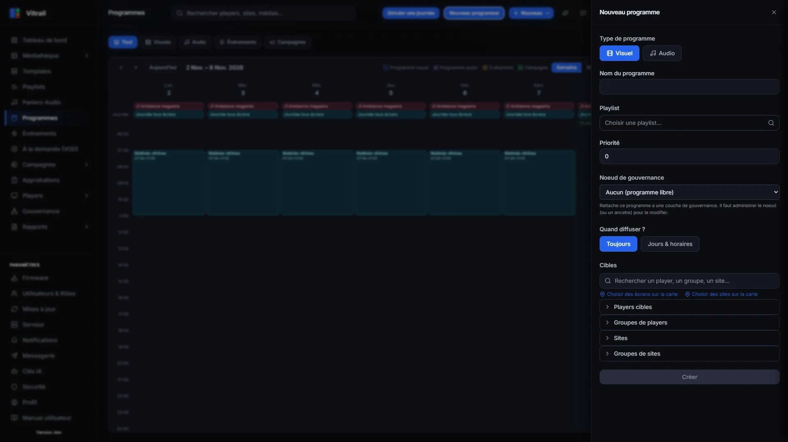

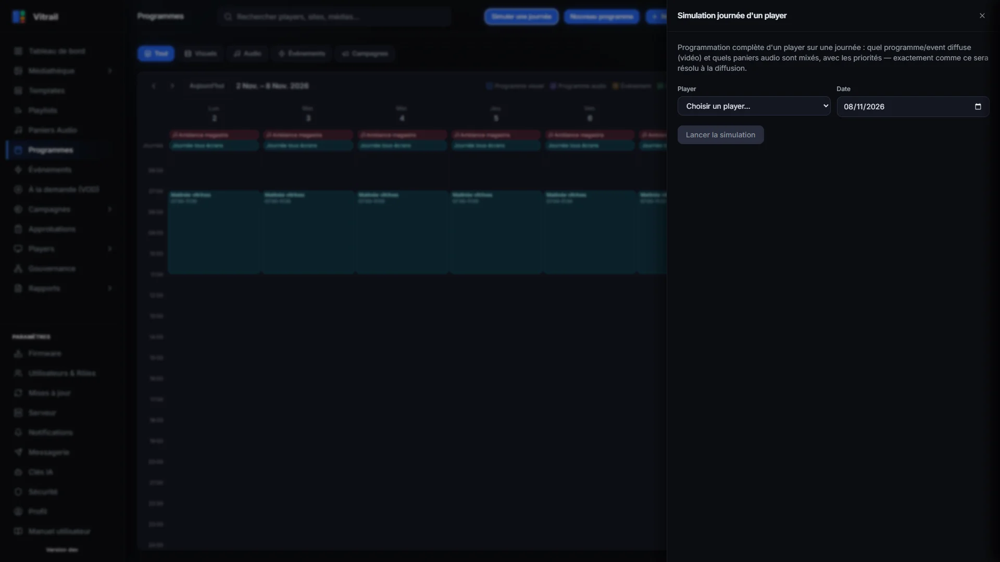

Les réseaux à plusieurs niveaux (siège, régions, magasins) composent leur programmation avec la **Gouvernance hiérarchique** — voir la section dédiée plus bas.

## Gouvernance hiérarchique (réseaux multi-sites)

La **Gouvernance** sert aux réseaux où plusieurs niveaux décident de ce qui s'affiche : un siège, des régions, des magasins. Chaque niveau compose **sa** part du programme, et les écrans diffusent la **somme** des niveaux dont ils dépendent. Une installation mono-site n'en a pas besoin : sans nœud, rien ne change (le champ « Nœud propriétaire » ne s'affiche même pas).

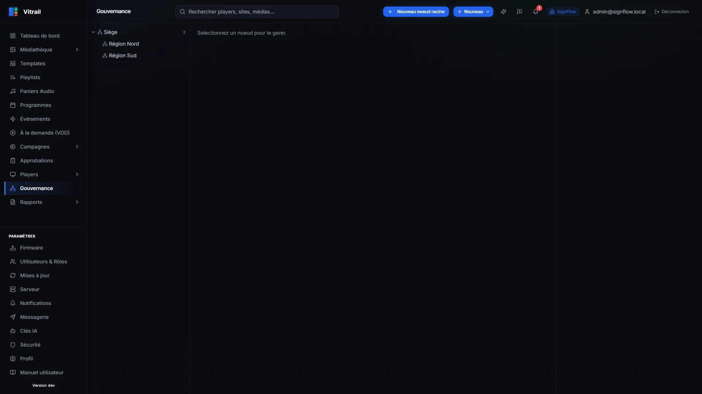

### Les cinq notions

- **Le nœud** est un niveau de l'organisation. C'est son **niveau** dans l'arbre (racine = 0) qui fixe l'ordre national → local, pas son « type », qui n'est qu'une étiquette.
- **Le périmètre** est l'ensemble des écrans qu'un nœud pilote : on y rattache des écrans, des groupes d'écrans, des sites ou des groupes de sites. Le périmètre d'un nœud **inclut celui de ses descendants** — rattacher les sites aux nœuds de magasin suffit.
- **La couche** : chaque programme rattaché à un nœud produit une couche. Un écran compile toutes les couches des nœuds dont il dépend. C'est ce que montre la colonne « Programme compilé », **pour cet écran et à cet instant**.
- **La règle** dit combien chaque niveau peut prendre. La plus utilisée est « **nombre de contenus par tour** » : avec 1, chaque niveau place un contenu par tour et fait **tourner** ses contenus.
- **L'administrateur de nœud** décide pour ce nœud. ⚠️ Une permission ne suffit **jamais** : c'est cette affectation qui autorise à écrire.

### Qui peut quoi

L'administrateur d'un nœud agit sur **son nœud et tout son sous-arbre**. Il voit les niveaux au-dessus **en lecture seule** et ne voit **pas du tout** les branches voisines. Trois gestes remontent toujours d'un cran : **détacher** un contenu de la gouvernance, **retirer la modération** ou **lever une restriction**, et **valider** une soumission — le valideur doit administrer un nœud **parent**, et personne ne valide sa propre soumission. Créer un nœud **racine** est réservé à l'administrateur d'organisation.

- **Gouvernance — Directeur** : bâtit la structure — nœuds, périmètres, administrateurs, règles. Voit le contenu, ne le produit pas.
- **Gouvernance — Programmeur** : crée les **programmes** et les **playlists** de ses nœuds, soumet à l'approbation.
- **Gouvernance — Éditeur** : produit le contenu (playlists, médias) et le soumet. Ne supprime aucun média, ne programme pas.
- **Gouvernance — Valideur** : approuve, rejette ou demande des modifications sur son sous-arbre.

Ces quatre rôles portent une **sémantique de périmètre** : leur porteur n'agit que dans son sous-arbre, et **le contenu non gouverné lui est invisible**.

### Le contenu gouverné

Une playlist, un média, un template, un événement et une configuration VOD peuvent appartenir à un nœud (champ « Nœud propriétaire »). Sans nœud, l'objet appartient à l'organisation et se comporte comme avant. Un objet rattaché n'est modifiable que par les administrateurs de son nœud ou d'un nœud parent ; si le nœud est marqué **« Contenu soumis à approbation »**, on **soumet** au lieu de publier, et c'est la validation qui publie. Cette modération est **héritée vers le bas**.

⚠️ **Deux malentendus qui coûtent cher.** Rattacher une playlist à un nœud décide **qui l'édite** ; ça ne la **diffuse pas** — la diffusion vient d'un **programme** rattaché au même nœud. Et le **rôle** dit ce qu'on peut faire, l'**affectation d'administrateur** dit **où**.

### Viser une partie des écrans d'un nœud

Par défaut, un programme rattaché à un nœud diffuse sur **tous** ses écrans. Pour n'en viser qu'une partie, ajoutez-lui des **cibles** : elles **restreignent** le périmètre, ne l'élargissent jamais, et un niveau inférieur ne peut jamais restreindre une couche **héritée**. Une cible qui ne retient aucun écran est refusée en la nommant, et le nombre d'écrans retenus est affiché. **Laisser un programme sans cible est souvent le bon choix** : il couvre alors tout son nœud, y compris les sites ajoutés plus tard.

### Exemple complet : entrée et sortie de magasin

Objectif : dans chaque magasin, l'écran d'**entrée** et celui de **sortie** diffusent un contenu **en plus** des autres, et le responsable du magasin change lui-même ses contenus et ses programmes.

**L'arbre** — `National` → `Dpt-01` → `Site-01`, `Site-02`.

**Le périmètre** — on rattache **le site** au nœud de magasin. Le département et le national n'ont **aucune affectation** : ils héritent du sous-arbre.

**Deux groupes d'écrans** — « Entrées » contient l'écran d'entrée **de chaque** magasin, « Sorties » les sorties. Le groupe marque le **rôle** de l'écran, le nœud marque le **magasin** : le croisement des deux désigne le bon écran, sans créer un groupe par magasin.

**Les contenus** — chaque magasin possède **ses propres** playlists : locale, entrée, sortie. 🔑 Une playlist partagée entre deux magasins n'est modifiable que par son propriétaire — l'autre responsable ne peut même pas la lire.

**Les programmes** — un par nœud, plus deux par magasin :

- **National** — programme « SC National », **sans cible** : tous les écrans du réseau.
- **Dpt-01** — programme « SC Dpt », **sans cible** : tous les écrans du département.
- **Site-01** — programme « SC Site-01 », ciblé sur les écrans du magasin : le contenu local.
- **Site-01** — programme « SC Entrée Site-01 », ciblé sur le groupe « Entrées » : l'entrée seulement.
- **Site-01** — programme « SC Sortie Site-01 », ciblé sur le groupe « Sorties » : la sortie seulement.

Avec « nombre de contenus par tour = 1 » sur chaque nœud, les écrans ordinaires diffusent **3 contenus par tour** (national + département + local) et l'entrée comme la sortie en diffusent **4**.

**Ajouter un magasin** tient alors en cinq gestes : créer le nœud sous le département, y rattacher le site, créer ses trois playlists, créer ses trois programmes, ajouter son écran d'entrée au groupe « Entrées » et celui de sortie au groupe « Sorties ». Les programmes national et département n'ont pas à être touchés.

### Composer un périmètre à l'échelle

Le bouton **« Ajouter des écrans »** ouvre une recherche **côté serveur** : filtrez par nature (écran, groupe d'écrans, site, groupe de sites), sélectionnez **plusieurs cibles d'un coup**, et chaque ligne annonce **le nombre d'écrans qu'elle représente**. Un écran encore rattaché à **aucun** nœud est proposé et **étiqueté** : c'est ainsi qu'un oubli d'installation se voit et se répare.

### Réorganiser et diagnostiquer

Un nœud peut être **déplacé** sous un autre parent : chemins, niveaux et diffusion de tout son sous-arbre suivent. On ne peut pas le déplacer sous un de ses propres descendants, ni dans une branche qu'on n'administre pas.

Quand l'aperçu d'un écran est vide, le message **nomme la cause** : pas de nœud, pas de programme sur le nœud, programme inactif, sans playlist, **sans règle horaire** (il ne sera jamais actif), ou hors de sa fenêtre à cet instant.

## Événements

Un **événement** prend temporairement la priorité sur la programmation : promotion, annonce, contenu déclenché.

- Contenu : une playlist ou un seul média. Cible : org, site, groupe ou player — et les types se **mélangent** dans un même événement (« ce site » + « ces 3 écrans », comme les campagnes) : les sélections se cumulent, le récapitulatif nomme tout ce qui est retenu. « Toute l'organisation » remplace les autres sélections.
- Types : **manuel** (déclenché à la demande), **programmé** (fenêtre date/heure, éventuellement récurrent).
- **Spot horaire** : sur un événement programmé en « Jouer une fois », activez la répétition à intervalle fixe (ex. un spot toutes les 30 minutes). Le champ n'apparaît que dans cette combinaison.
- **Fuseau de référence** (événement programmé) : il dit ce que « 18:00 » veut dire. Par défaut, le fuseau du serveur. Sur un réseau à cheval sur plusieurs pays, choisissez-le explicitement — un événement s'active à **un seul instant**, pas à 18:00 dans chaque pays. Le fuseau est rappelé à côté de l'horaire dans la liste.
- ⚠️ À ne pas confondre avec l'**embargo**, qui est un instant **absolu** (UTC) : il ne dépend d'aucun fuseau et n'est pas affecté par ce réglage.
- Option **« garder les écrans allumés »** : maintient l'affichage pendant l'événement même hors horaires d'ouverture (soirée exceptionnelle).
- À la fin, le player revient exactement à sa programmation (heure courante).
- Un événement **(ré)activé en cours de fenêtre** avec un média jamais distribué peut mettre quelques minutes à apparaître (le player télécharge d'abord le fichier — jamais d'écran noir). Activez/planifiez à l'avance pour une bascule instantanée.

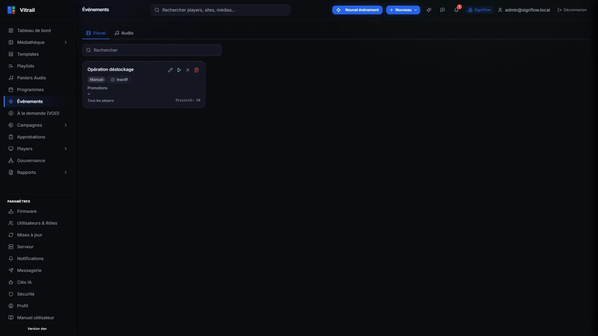

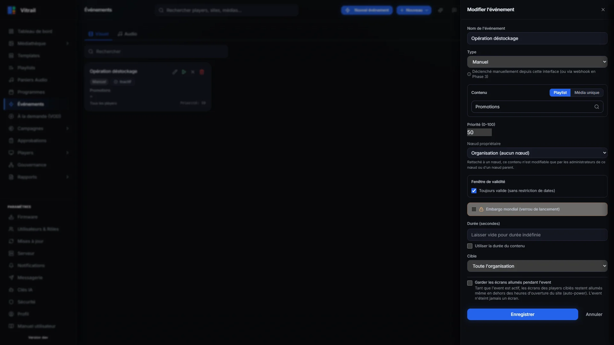

## Diffusion à la demande (VOD)

La page **On-Demand** diffuse un contenu immédiatement, par-dessus la programmation, sans toucher aux playlists. Une **config VOD** regroupe des médias et une cible : soit des **players choisis** (d'un même site), soit un **site entier** — dans ce cas tout player ajouté au site plus tard est pris en compte automatiquement ; les médias sont pré-téléchargés, le déclenchement est instantané : **Une fois** ou **En boucle** (jusqu'au Stop). La permission `vod : trigger` seule suffit pour un compte « magasin ». À la fin, la programmation reprend à l'heure courante.

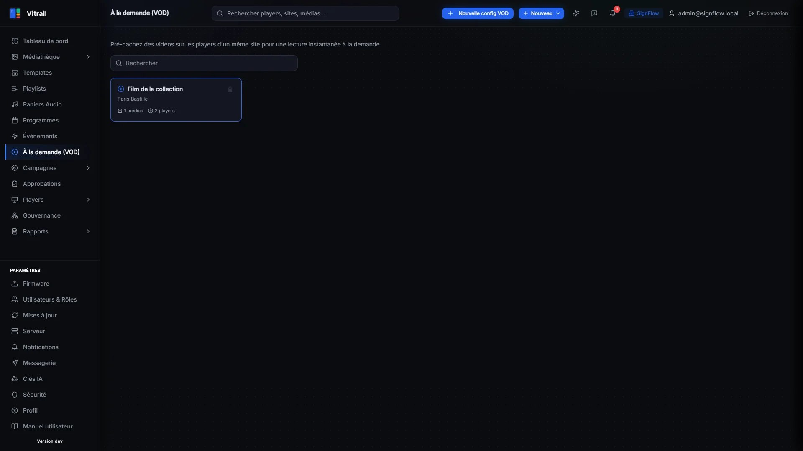

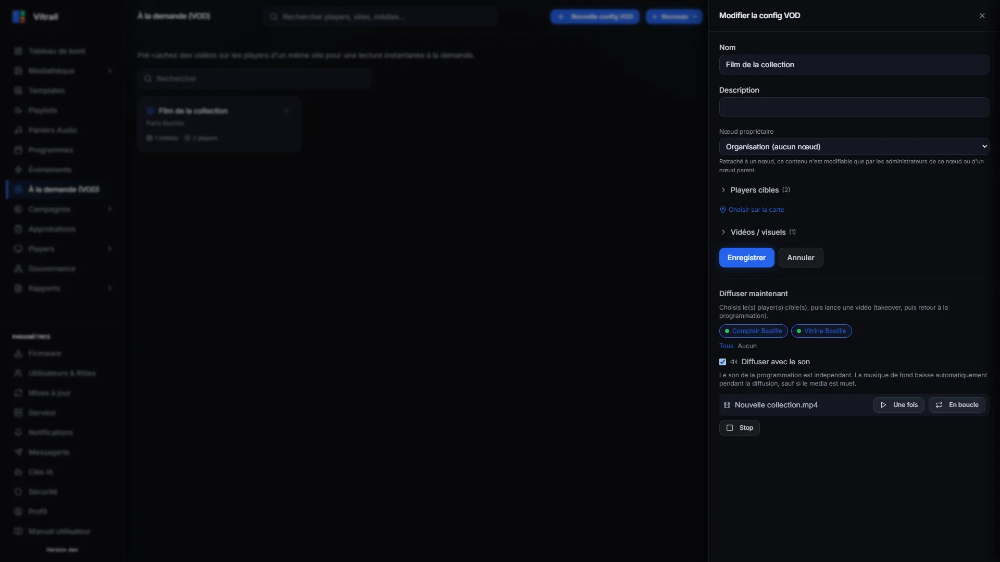

> Particularités **BrightSign** : le démarrage et l'arrêt peuvent mettre **jusqu'à 2 secondes** (relais local embarqué) — c'est normal. Pendant la diffusion, la playlist est suspendue (un seul flux vidéo matériel sur ces players) puis reprend à l'heure courante. Le pré-téléchargement initial peut prendre du temps sur des fichiers 4K : tant qu'un média n'est pas en cache, il est lu en streaming (démarrage différé).

## Entrée HDMI

Le média **« Entrée HDMI »** affiche n'importe quelle source branchée sur l'entrée HDMI du player (décodeur TV, box, console) — lecture purement locale. Compatible : BrightSign à entrée HDMI (gammes XT, 4K114x, XD1230).

- **En playlist** : un créneau bascule sur la source puis reprend la playlist ; les players sans entrée ignorent l'item. Sans signal, l'écran affiche « No Signal Detected » (jamais d'écran noir).
- **À la demande** : via une config VOD, boutons **Basculer sur HDMI / Revenir à la playlist** (reprise à l'heure courante).
- **Page locale** : chaque BrightSign compatible sert `http://<ip>:8888/control` — bascule/retour depuis un téléphone du magasin, sans compte ni serveur (activation + PIN par player).
- Garde-fous : une bascule restée active est terminée à l'extinction de l'écran ; chaque session est tracée (audit + preuve de diffusion signée avec la durée réelle).

## Feeds et pages web

### Feeds (flux d'actualité)

Un **feed** est une source pollée par le serveur : RSS/Atom, Google News, YouTube, météo, crypto, finance, réseaux sociaux (via le proxy de flux). Modes d'affichage : bandeau défilant, carrousel, grille, article plein écran, mise en page divisée, liste, mur social, graphique. Options : **résumé IA** des articles (une phrase lisible de loin), **modération** (valider chaque article avant diffusion), vignettes en cache sur le player (fonctionne hors-ligne).

### Pages web (URL Display)

Affichez une page web à l'écran : mode **WebView** (rendu en direct sur le player) ou **capture serveur** (le serveur photographie la page périodiquement — pour les pages qui refusent l'intégration ou exigent une authentification côté serveur). Une page web est un média comme un autre : tags, playlists, programmation.

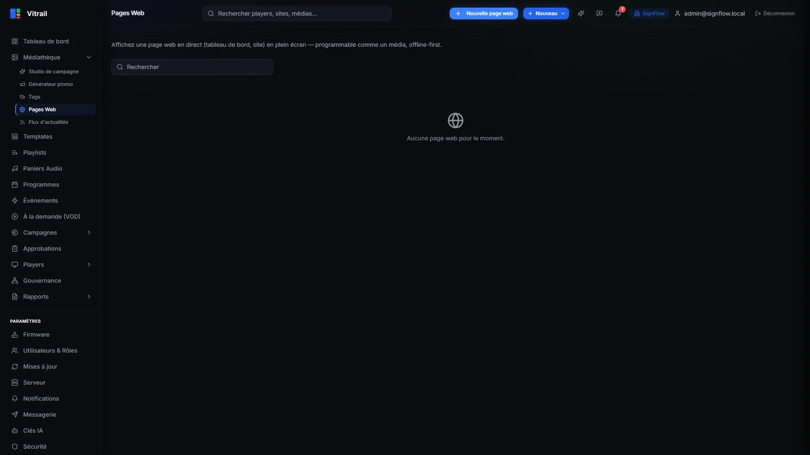

## Génération IA

Vitrail génère images, vidéos, musique et voix à partir d'une description. Le média généré rejoint la médiathèque normalement.

- **Pré-requis** : les clés IA de votre organisation (**Paramètres → Clés IA**) — fal.ai (images/vidéos/musique/voix), ElevenLabs (audio pro), Anthropic (assistant de rédaction et Studio). Vous payez votre propre fournisseur ; sans clé, la fonction est inactive.
- **Où** : Médiathèque → **Générer (IA)** pour un asset ; **Studio** pour une campagne complète à partir d'un brief (concepts déclinés par format, coût total affiché avant génération).
- **Prompts** : les modèles travaillent en anglais — l'**assistant de rédaction** transforme votre idée (toute langue) en prompt anglais optimisé + prompt négatif. Restez simple : sujet + action + style ; pour la vidéo, ajoutez caméra et lumière ; jamais de méta-instructions (« contenu promotionnel… » finit dessiné à l'image).
- **Édition** : détourage (suppression de fond), retouche par instruction, variations multiples, image → vidéo (décrivez seulement le mouvement).
- Un **estimatif de coût** s'affiche avant chaque génération.

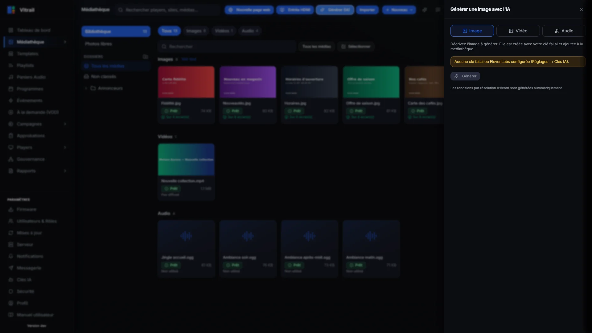

## Générateur promo

Le **Générateur promo** fabrique une affiche promotionnelle (image ou vidéo courte) à partir d'un produit, d'un prix et d'une mise en page. Le résultat rejoint la médiathèque et se diffuse comme n'importe quel média.

- **Où** : Médiathèque → **Générateur promo**.
- **Un parcours en six étapes** : **Pour qui ?** · **Le produit** · **Texte et prix** · **Mise en page** · **Le fond** · **Retouches libres**. Une seule étape est ouverte à la fois, pour que tous ses champs tiennent à l'écran ; repliée, elle **affiche sa valeur**. On les ouvre dans n'importe quel ordre.
- **« Pour qui ? » d'abord** : mon enseigne ou un annonceur — la **charte s'en déduit** (couleurs, police, logo, mentions), au lieu d'être choisie.
- **Partir d'une URL produit** : collez l'adresse d'une fiche, le nom, le prix et la photo sont extraits. Tout reste modifiable : c'est une aide à la saisie, pas une source de vérité.
- **Le prix est obligatoire.** Le bouton **Générer** reste éteint tant qu'il manque, et le bandeau sous l'aperçu dit ce qui manque **et emmène à l'étape concernée**. Le même bandeau signale les défauts de lisibilité, re-vérifiés par le serveur avant de produire.
- **L'IA ne fait que le fond** (et le détourage du produit). Prix, remise, nom et mentions légales sont posés par le compositing à partir de votre saisie — donc exacts.
- **Enchaîner** : « Refaire avec un autre produit » garde marque, mise en page, fond et mentions ; les **préréglages** rappellent une configuration complète.

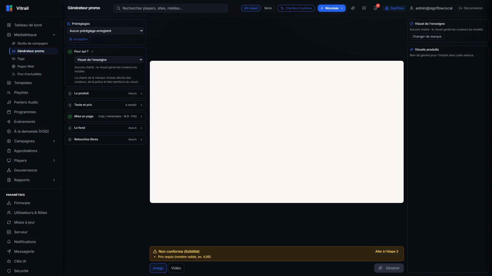

### Mode série — un gabarit, N produits

La bascule **Un visuel / Série**, en haut, remplace l'aperçu par un **tableau** : une ligne par visuel. Le parcours de gauche continue de définir ce qui est **commun** (marque, mise en page, fond, mentions, devise) ; le tableau ne porte que ce qui **varie** — produit, slogan, prix, prix barré, remise.

- **Trois façons de le remplir, cumulables** : ajouter une ligne à la main, **importer un CSV**, ou **coller depuis un tableur** (Excel, Google Sheets). Les en-têtes sont reconnus en français comme en anglais, dans n'importe quel ordre. ⚠️ Sans en-tête reconnu, les colonnes sont lues **dans l'ordre** et l'écran le signale — vérifiez le tableau.
- **L'import ajoute**, il ne remplace pas : on peut importer deux fichiers, ou compléter à la main.
- **Une ligne sans prix n'arrête pas la série** : elle est surlignée, nommée dans l'avertissement, et ignorée. Le bouton indique combien de visuels partiront réellement.
- Chaque visuel est **nommé d'après son produit**, sinon ils arriveraient tous sous le même nom dans la médiathèque.

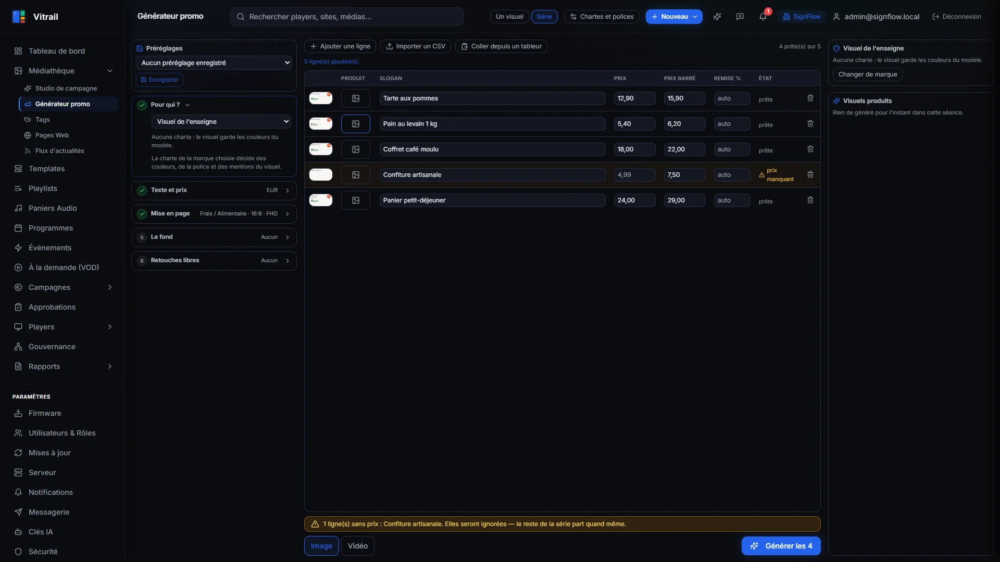

## Chartes de marque

Une **charte de marque** déclare une fois pour toutes les couleurs, la police, le logo, les mentions légales et le ton d'une marque. Le **Générateur promo** s'en sert ensuite pour pré-remplir chaque visuel.

- **Deux portées** : une charte pour votre **organisation**, et une par **annonceur**. Quand un visuel est fait pour un annonceur, c'est la sienne qui s'applique ; sinon celle de l'organisation.
- **Où** : Générateur promo → bouton **Chartes et polices** dans la barre du haut. Réservé à l'administrateur d'organisation.
- **Une charte ne remplace que ce qu'elle déclare** : une couleur laissée décochée signifie « la charte ne dit rien », et le modèle garde la sienne. C'est ce qui permet d'imposer une seule couleur d'accent sans écraser les autres.
- **Elle pré-remplit, elle ne verrouille pas** : sur un visuel donné, ce que vous saisissez l'emporte sur la charte. Les mentions légales sont recopiées une seule fois — effacées volontairement, elles ne reviennent pas.
- **Le logo et le nom ne sont jamais dessinés par l'IA** : un fond généré ne reçoit que la palette et le ton, comme atmosphère à viser. Logo, nom de marque et mentions sont posés ensuite par le compositing, donc exacts. Le bouton « Poser le logo de la marque » l'ajoute comme calque déplaçable.
- Tant qu'aucune charte n'existe, rien ne change : les visuels gardent les couleurs de leur modèle.

## Campagnes (retail media)

La page **Campagnes** vend vos écrans comme inventaire publicitaire : un annonceur achète une **part de voix (SOV)** — un pourcentage du temps d'antenne — sur une période et des écrans donnés.

### Annonceurs et exclusion concurrentielle

Créez vos **annonceurs** (page Annonceurs) : chacun reçoit un dossier médiathèque « Annonceurs/<nom> » et une ou plusieurs **catégories d'industrie**. Sur chaque **site**, listez les catégories **exclues** : les annonceurs concernés ne peuvent ni cibler ni diffuser sur ce site (appliqué au ciblage, à l'occupation, au devis, au rapport, au portail et à la diffusion).

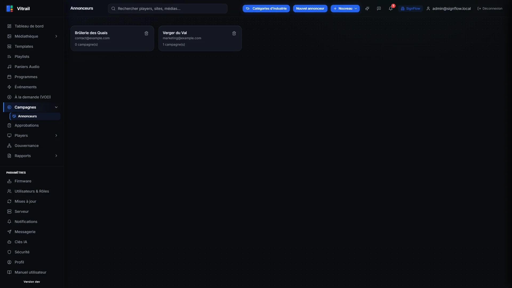

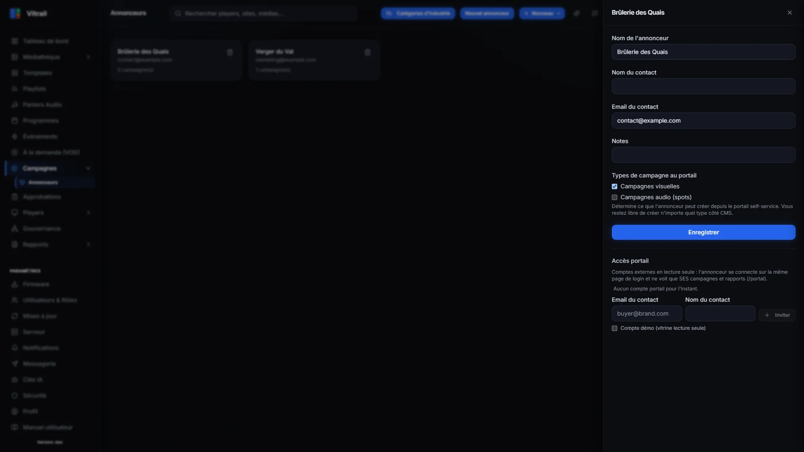

### Créer et publier une campagne

Une campagne = période (+ fenêtre horaire quotidienne optionnelle), **SOV vendue en %**, prix (SOV ou forfait, saisi manuellement — un **devis indicatif** est calculé d'après les tarifs par écran), cibles (cumulables : org, sites, groupes de sites, groupes, players) et créatifs (vidéos/images, rotation pondérée). Statuts : brouillon → publiée (programmée / live / terminée), pause (retrait immédiat des écrans), reprise, annulation.

- **Inventaire** : la projection d'occupation avertit à 80 % et bloque à 100 % du **plafond** de chaque écran (plafond réglable par player ou site — ex. écran de caisse limité à 20 %) ; un org-admin peut forcer (surbooking assumé).
- **Tarifs** : € pour 1 % de SOV par jour, hérités org → site → player.
- **SOV réalisable** : un bandeau ambre signale quand la SOV demandée dépasse ce que la boucle réellement programmée permet, avec un bouton « Utiliser X % ».
- **Durée max des créatifs** : réglable par org (défaut 30 s) — refus à l'ajout et re-vérification à la publication.
- **Approbation des créatifs** (optionnelle, par org) : tout nouveau créatif naît « En attente » et doit être approuvé avant diffusion.
- **Calendrier** : Gantt mensuel des campagnes avec charge par jour (ambre/rouge).
- **Import** : campagne complète depuis un JSON (aperçu dry-run, création en brouillon, publication manuelle), aussi disponible **par API** avec une clé `sfi_`.

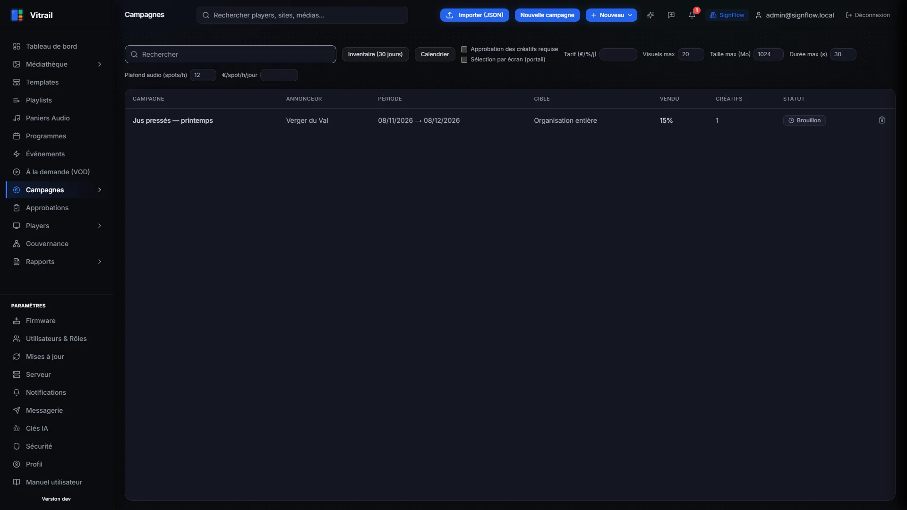

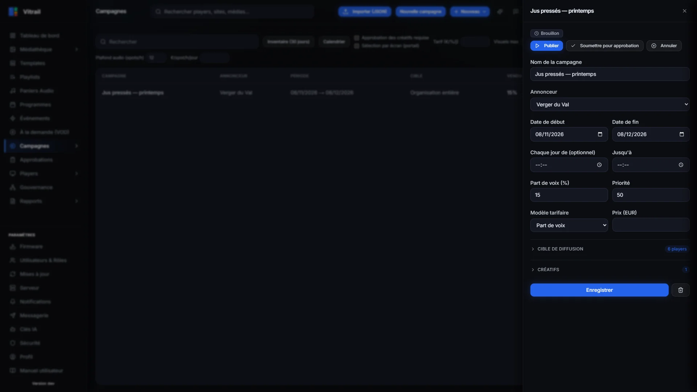

### Diffusion, preuve et rapport

Les créatifs sont **intercalés dans la boucle existante** à la fréquence de la SOV vendue — jamais deux spots dos à dos (au plus une publicité par tour de boucle ; l'excédent devient du sous-service mesuré et alerté). Chaque passage émet une **preuve de diffusion signée** par l'écran. Le **rapport annonceur** donne passages, temps d'antenne, SOV servi vs vendu, répartition hiérarchique groupes → sites → écrans, montant — export **PDF white-label** et **lien public protégé** (mot de passe, allowlist IP). Notifications : campagne démarrée / terminée / **sous-servie**.

## Portail annonceur

Le **portail** (`/portal`) est l'espace white-label de vos annonceurs : chacun n'y voit que **ses** campagnes.

- **Ouvrir un accès** : drawer annonceur → section Accès portail → inviter par email (mot de passe initial affiché une seule fois). Un compte annonceur est toujours dirigé vers le portail, jamais vers le CMS.
- **L'annonceur peut** : suivre ses campagnes et rapports (PDF), **créer une campagne** (sites sur carte — les sites incompatibles avec sa catégorie sont grisés —, période, SOV ou **Exclusif** = 100 %, disponibilité agrégée ok/tendu/complet et **devis en direct**), téléverser ses créatifs (quotas réglables, défaut 20 fichiers / 1024 Mo — toujours revus avant diffusion), **soumettre pour validation**, corriger et resoumettre si des modifications sont demandées, enregistrer des **listes de sites**, choisir sa **langue** (5 disponibles).
- Si l'option **« Sélection par écran (portail) »** est activée pour l'organisation, l'annonceur peut cocher des écrans nominativement dans chaque site.
- Une **cloche** l'informe des décisions (et un email si vous le cochez à la décision).

## Approbations (validations)

La page **Approbations** centralise les demandes d'approbation — aujourd'hui les campagnes (soumises du CMS ou du portail).

1. **Soumettre** : « Soumettre pour approbation » (une seule demande active par ressource). Une campagne en revue ne peut pas être publiée.
2. **Revue** : le valideur voit tout — créatifs visionnables, annonceur, période, SOV demandée et réalisable, devis, cibles nommées, occupation projetée avec le détail des campagnes en place.
3. **Décision** : approuver / rejeter / demander des modifications (motif obligatoire), avec option d'**email à l'annonceur** (cochée par défaut). L'approbation approuve aussi les créatifs en attente de la demande.
4. **Resoumission** après corrections ; historique conservé.

Les valideurs (permissions `approvals`) voient la file de l'organisation entière et une **cloche** en topbar ; exports **CSV/PDF** de la file ; les demandes en statut terminal peuvent être retirées de la liste (trace conservée en audit).

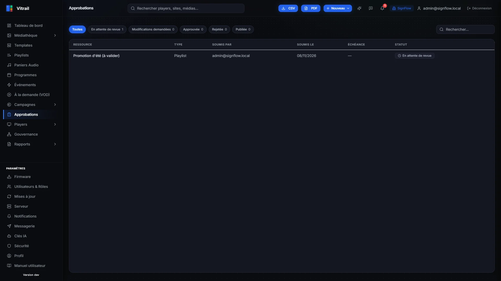

## Rapports et analytics

- **Executive Dashboard** : KPIs du réseau, **Network Health Score**, tendances — filtres par site/groupe, export **PDF white-label** (votre logo), envoi **planifié par email**.
- Dashboards spécialisés : NOC (santé du parc), contenu, géo (carte des sites), audience.
- **Proof of Play** : chaque lecture est enregistrée, chaînée (Merkle) et **signée par le player** — vérification d'intégrité et **certificat** exportable. Les rapports SACEM s'appuient dessus.
- **Liens de partage** : publiez un rapport en lecture seule protégé (mot de passe, allowlist IP) pour un client ou la direction.
- **Connecteurs BI** : trois flux CSV (clé API `sfr_`) pour Power BI, Tableau, Excel, Metabase.

## Notifications

**Paramètres → Notifications** : des **canaux** (webhook JSON ou **email**, jusqu'à 20 destinataires) et des **règles** qui y relient des événements : player hors ligne (la veille programmée ne sonne pas ; un parc pas réveillé après l'ouverture, si), feed en erreur, déploiement OTA échoué, campagnes (démarrée/terminée/sous-servie), validations (soumise/approuvée/rejetée/modifications). Bouton d'envoi de test sur chaque canal.

## Assistant IA et Jeanine

L'**assistant** (bouton en bas à droite ou **Ctrl+Shift+A**) connaît votre compte et cette documentation, et répond dans votre langue.

- **Lecture** : players (statut, pourquoi un écran est éteint), playlists (« qui la joue »), sites et **horaires d'ouverture**, programmations, médias (temps d'antenne prouvé, jamais diffusés), campagnes (statut, rapport), sessions HDMI, alertes.
- **Actions** : il **prépare** (jamais n'exécute seul) — ajout/retrait de médias en playlist, création de playlist/feed/événement/programme, redémarrage de players, capture d'écran, écran on/off, bascule HDMI, VOD, fuseau, rangement de médias, **mise à jour OTA des players** (dernière version stable). Vous confirmez d'un bouton ; les actions sensibles sont réservées à l'org-admin.
- **Jeanine (Telegram)** : le même assistant par messagerie. Liez votre compte depuis **Profil → carte Messagerie** (`/link CODE` au bot) ; l'org-admin gère les comptes liés dans Paramètres → Messagerie. Les actions sensibles (reboot, extinction, suppression de programme, OTA…) exigent votre **code PIN à 6 chiffres** (défini au profil ; 1 action, 2 minutes, verrouillage après 3 erreurs, message effacé du fil — jamais à la voix).
- **Vocal** : envoyez un message vocal (≤ 2 min) — transcription dans la langue de votre profil, réponse texte + note vocale (clés fal.ai et ElevenLabs requises).
- Coûts : l'assistant utilise les **clés IA de votre organisation** et respecte son quota.

## Mises à jour des players (OTA)

**Paramètres → Mises à jour** pilote les mises à jour à distance de tous les types de players. **Aucune mise à jour automatique sans votre approbation.**

- **Inventaire** : version courante vs dernière disponible **par plateforme**, filtres combinés (OS, version, état, site, groupe).
- **Catalogue** : vos versions publiées (SemVer, canal, plateforme).
- **Importer une version** (Linux/RPi/Windows/Android) : par **URL** ou par **fichier** (.tar.gz/.apk) — plateforme et version **détectées automatiquement**, aperçu avant validation ; l'archive est stockée sur votre serveur, les players la téléchargent de là.
- **Versions servies** (BrightSign/ChromeOS) : ces players prennent leur code **avec la mise à jour du serveur** ; **déclarez** la version servie pour la rendre déployable. **Épinglage** : mettre à jour le serveur n'avance **pas** un player tant que vous n'avez pas déployé la version vers lui — idéal pour tester sur un bac à sables avant le parc.
- **Flux recommandé** : publier en **Bêta** (invisible du parc) → déployer sur un groupe de test → **Passer en stable** → déployer largement.
- **Déploiement** : version + cibles (player, groupe, site, tags, org) + stratégie (immédiate, graduelle, programmée) + **fenêtres horaires** (téléchargement / installation en heure locale — pas de reboot en pleine journée). Suivi par player (téléchargement → prêt → installation → réussi/échec), anneau de progression, pause/reprise/annulation. Un player hors ligne applique à son retour.
- **Par l'assistant** : « mets à jour les players » propose la dernière stable de chaque plateforme aux players en retard (org-admin ; PIN par Telegram).

## Écrans et alimentation

Vitrail allume et éteint vos écrans selon les **horaires d'ouverture du site** — le player reste allumé, seul l'écran est piloté.

1. Renseignez les horaires du site (avec exceptions et jours fériés) et activez l'**auto-power** (marges avant/après optionnelles).
2. Sur chaque player : **Suivre les horaires du site** (recommandé), fenêtre personnalisée, toujours allumé, ou manuel.
3. Pilotage selon l'équipement : contrôleur **RS232/IP** (écrans pro), **HDMI-CEC**, ou repli **coupure de la sortie vidéo** (l'écran se met en veille).

Chaque player connaît ses fenêtres d'allumage **14 jours à l'avance** : serveur injoignable, il pilote son écran tout seul. Un player éteint par le programme est marqué **« Veille programmée »** — aucune alerte ; s'il n'est pas revenu après l'ouverture, une alerte part. Les boutons Allumer/Éteindre du drawer sont ponctuels ; un événement peut « garder les écrans allumés ».

## Serveur et durée des encodages

Chaque vidéo importée est **ré-encodée** pour que tous les écrans puissent la lire — c'est la tâche la plus lourde du serveur. La page **Paramètres → Serveur** dit pourquoi elle prend le temps qu'elle prend.

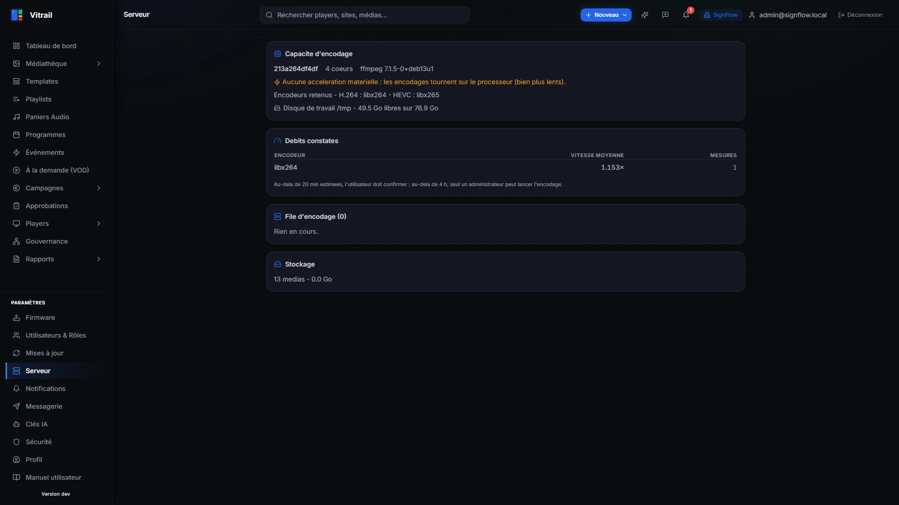

**Capacité d'encodage** — la ligne qui explique presque tout : **accélération matérielle active** ou non. Sans carte graphique exploitable, les encodages tournent sur le processeur et sont bien plus lents. **Débits constatés** = les vitesses réellement mesurées sur vos propres fichiers. **Disque de travail** = l'espace libre là où le worker écrit ses fichiers temporaires.

> **« Aucun worker média ne répond »** n'est pas un détail d'affichage : aucun encodage ne peut aboutir. Ces informations viennent du **worker**, pas du serveur web — quand il se tait, la page le dit plutôt que d'afficher des valeurs périmées.

**Avant de lancer un encodage, le serveur mesure** : il encode une dizaine de secondes de **votre** fichier avec la commande exacte qui sera utilisée, puis extrapole. Trois cas : **moins de 20 min**, l'encodage part seul · **de 20 min à 4 h**, c'est vous qui décidez et le média attend en **Décision requise** · **plus de 4 h**, c'est refusé par défaut, un administrateur pouvant passer outre. Un refus n'est pas une impasse : l'écran propose d'encoder en **définition inférieure**, chacune avec sa propre estimation.

Cette page est réservée au **détenteur de la licence**. Si votre serveur est administré par un prestataire, l'écran vous l'indique : la capacité et la file relèvent de son exploitation, vos contenus sont traités normalement.

## Utilisateurs, rôles et sécurité

**Rôles fournis** — cette liste ne contient que les droits **réellement appliqués par le serveur** :

- **Administrateur d'organisation** : tout, dans son organisation.
- **Designer** : médias et templates (créer/modifier/supprimer), playlists (créer/modifier).
- **Programmateur** : programmation, événements et VOD (créer/modifier/déclencher) ; lecture players, playlists, médias.
- **Responsable campagnes** : campagnes de bout en bout (créer, publier, rapports) ; lecture médias, templates, rapports.
- **Approbateur** : examiner, approuver ou rejeter les demandes ; lecture médias, playlists, templates.
- **Lecteur de rapports** : consultation des rapports uniquement.
- **Opérateur magasin** : piloter les paniers audio de son magasin.
- **Gestionnaire de gouvernance** : configurer la hiérarchie de gouvernance (nœuds, délégations) ; lecture des contenus.
- **Éditeur de gouvernance** : composer le contenu de son nœud (playlists, médias, flux) et le soumettre à l'approbation ; **ne supprime pas** les médias.
- **Valideur de gouvernance** : trancher les demandes d'approbation de son périmètre ; **jamais sa propre soumission**, et seulement depuis un nœud supérieur.
- **Programmeur de site** : programmer la diffusion des **nœuds dont il est administrateur** (sa portée vient de son affectation de nœud, pas du droit seul).
- **Observateur** : lecture seule sur l'ensemble.
- **Annonceur (portail)** : ses propres campagnes et leurs rapports, depuis le portail.

> **Les menus s'adaptent au rôle** : ce qu'un utilisateur ne peut pas utiliser est masqué. Un menu « disparu » signifie un droit de lecture manquant, pas une panne.

> Les rôles **Utilisateur API** et **Player** n'accordent rien et ne sont plus proposés : les intégrations utilisent des **clés API**, les players un **jeton machine**.

> **Rôle personnalisé** : créez-le puis **cliquez sur sa ligne** pour cocher ses permissions. Les rôles système sont en lecture seule ; les permissions grisées « à venir » correspondent à des fonctionnalités pas encore développées.

- **Paramètres → Utilisateurs & Rôles** : utilisateurs, **groupes** (les rôles du groupe s'ajoutent à ceux du compte ; portée org/site/groupe de players) et **rôles personnalisés** composés de permissions atomiques `module : opération` (voir la liste ci-dessus).
- La suppression d'un utilisateur est une **désactivation** (l'email reste réservé) ; supprimer un compte annonceur le délie du portail.
- **2FA (TOTP)** : activable par utilisateur, imposée aux administrateurs.
- **Clés API** : exports BI (`sfr_`), import de campagnes (`sfi_`) — valeur affichée une seule fois, révocables.
- **Paramètres → Sécurité** : politique de session, tentatives de connexion.
- Chaque action sensible est tracée dans le **journal d'audit**.

## Profil et préférences

**Paramètres → Profil** : nom, email, mot de passe, **langue de l'interface** (français, anglais, espagnol, portugais, allemand — l'assistant et les emails suivent), thème clair/sombre (bouton en topbar), 2FA, **carte Messagerie — Telegram** (liaison Jeanine + **code PIN** des actions sensibles), réactivation des bulles d'aide.

## Dépannage express

- **Player hors-ligne** : vérifiez alimentation, réseau, URL du serveur. Hors horaires d'ouverture, « Veille programmée » est normal (l'auto-power a éteint l'écran ; certaines box coupent aussi le réseau).
- **« No Signal Detected »** : la source HDMI branchée n'émet pas (éteinte, débranchée) — l'image revient seule dès que le signal revient.
- **« Média indisponible »** : player pas à jour pour ce type de contenu, ou transcodage serveur pas terminé.
- **Écran noir/figé** : vérifiez le transcodage ; sur un mur synchronisé, gardez le groupe homogène ; « Infos à l'écran » affiche le diagnostic sur place.
- **Pas de son** : vérifiez le rôle audio du player (standard / audio seul / mixte), le volume poussé et le mute.
- **Le contenu ne change pas** : player en ligne ? La programmation cible-t-elle bien ce player/groupe ? Toute modification pousse normalement une synchronisation immédiate.
- **Hors-ligne** : les players natifs jouent leur contenu localement (playlists, vidéos, feeds en cache) même serveur coupé ; l'extension Chrome est plus dépendante du réseau.

> Besoin de plus ? Posez la question à l'assistant (Ctrl+Shift+A) — il connaît ce manuel et l'état de votre compte.
